

  CREATIVE TECHNOLOGIST　·　AI PRODUCT ENGINEER　·　SYSTEMS THINKER

  <a href="#featured-work">WORK</a>　　
  <a href="#what-i-do">CAPABILITIES</a>　　
  <a href="#toolchain">TOOLCHAIN</a>　　
  <a href="#current-focus">FOCUS</a>　　
  <a href="mailto:sheen_liu@yahoo.com">CONTACT</a>

  <picture>
    <source media="(prefers-color-scheme: dark)" srcset="assets/intro-infographic.gif" />
    <source media="(prefers-color-scheme: light)" srcset="assets/intro-infographic-light.gif" />
    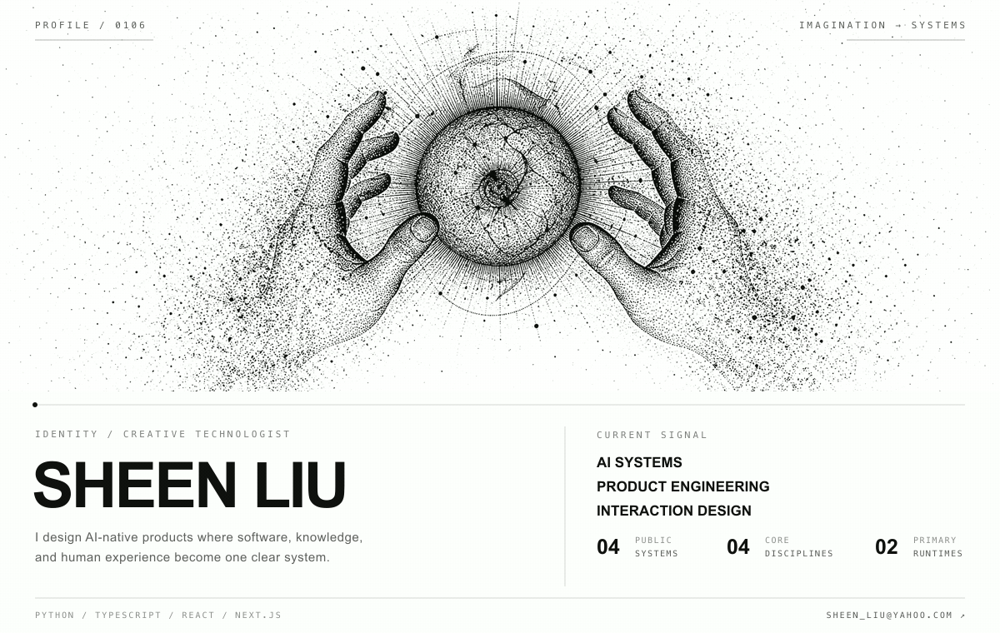
  </picture>

  
  

 

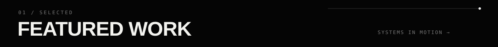

  <a href="https://github.com/SheenLiu0106/interaction-intelligence-audit">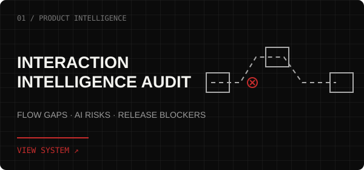</a>
  <a href="https://github.com/SheenLiu0106/content-to-pdf-agent-hub">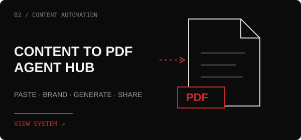</a>

  <a href="https://github.com/SheenLiu0106/research-agent">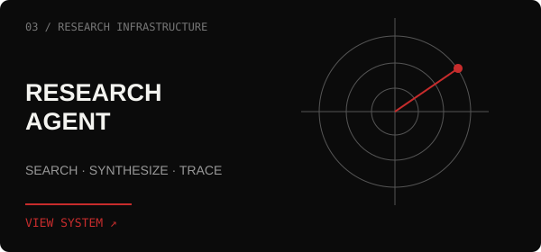</a>
  <a href="https://github.com/SheenLiu0106/ai-marketing-skills">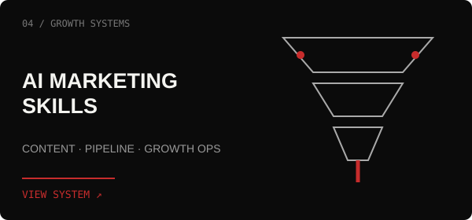</a>

 

|  | DISCIPLINE | DIRECTIVE |
|:--:|:--|:--|
| **01** | **AI SYSTEMS** | Design agentic workflows that reason, coordinate, and act. |
| **02** | **PRODUCT ENGINEERING** | Move from research and architecture to dependable software. |
| **03** | **KNOWLEDGE DESIGN** | Give complex information structure, context, and retrieval paths. |
| **04** | **INTERACTION DESIGN** | Make intelligent systems understandable and controllable. |

 

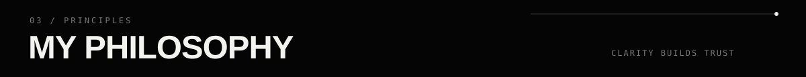

<table>
  <tr>
    <td width="58%" valign="middle">
      <h2>GOOD SYSTEMS MAKE COMPLEXITY VISIBLE. GREAT ONES MAKE IT <strong>CONTROLLABLE.</strong></h2>
    </td>
    <td width="42%" valign="middle">
      
I believe AI products should expand human judgment—not hide it behind automation.

      
Clarity is architecture. Trust is interaction design. The interface is part of the intelligence.

    </td>
  </tr>
</table>

 

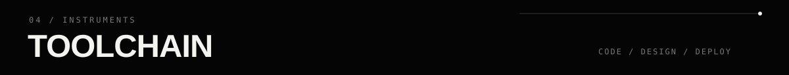

  

  <code>PYTHON</code>　<code>TYPESCRIPT</code>　<code>REACT</code>　<code>NEXT.JS</code>　<code>FASTAPI</code>　<code>POSTGRESQL</code>

 

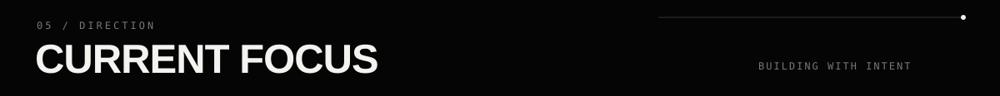

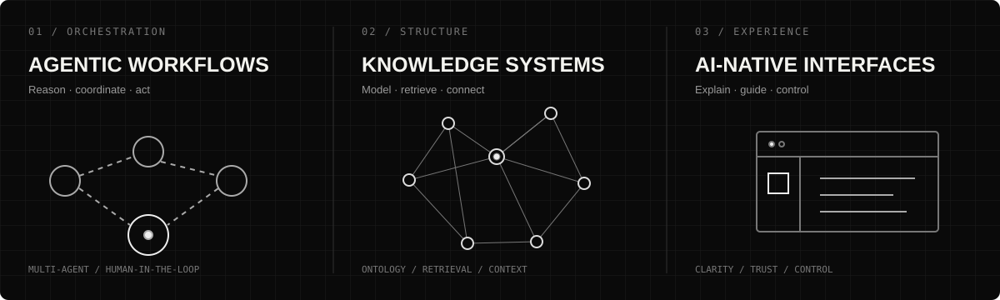

 

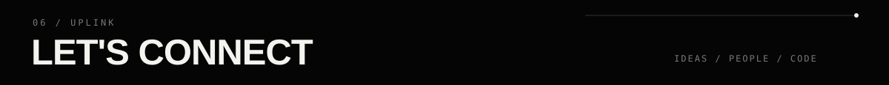

<table>
  <tr>
    <td width="58%" valign="middle">
      <h2>HAVE A SYSTEM IN MIND? LET'S BUILD IT.</h2>
    </td>
    <td width="42%" valign="middle">
      
Open to thoughtful collaborations around AI systems, product engineering, and interaction design.

      
<strong>Email</strong> <a href="mailto:sheen_liu@yahoo.com">sheen_liu@yahoo.com ↗</a>

      
<strong>GitHub</strong> <a href="https://github.com/SheenLiu0106">@SheenLiu0106 ↗</a>

    </td>
  </tr>
</table>

  DESIGNING INTELLIGENCE　·　BUILDING CLARITY　·　SHIP / OBSERVE / REFINE

